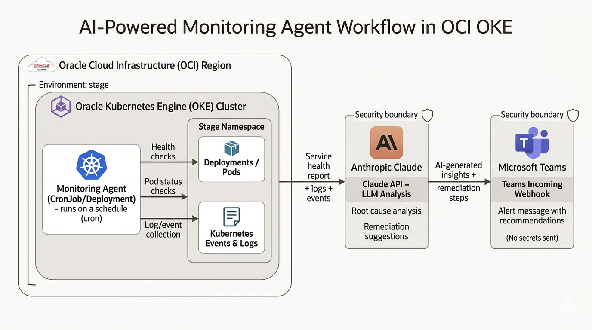

# Claude Observability Agent

A production-ready monitoring agent for Oracle Kubernetes Engine (OKE) that:

1. Discovers services in the **apps-stg** environment
2. Checks Kubernetes Deployment / Pod health
3. Collects events, logs, and resource context for unhealthy services
4. Sends the context to **Claude** (Anthropic) for root-cause analysis
5. Posts a structured alert card to **Microsoft Teams** via Microsoft Graph API

---

## Architecture



### Key components

| File | Responsibility |
|---|---|
| `agent/monitor.py` | Entry point, orchestrates the check cycle |
| `agent/config.py` | All configuration from environment variables |
| `agent/health_checker.py` | `discover_stage_services()` + `check_service_health()` |
| `agent/context_collector.py` | `collect_context()` — events, logs, deployment spec |
| `agent/claude_analyzer.py` | `analyze_with_claude()` — prompt + JSON parsing |
| `agent/teams_notifier.py` | `send_to_teams()` — Adaptive Card via MS Graph API |
| `k8s/rbac.yaml` | ServiceAccount + ClusterRole (read-only) — apply once by admin |
| `k8s/ci-deployer-role.yaml` | Grants CI runner CronJob permissions — apply once by admin |
| `k8s/secret.yaml` | Secret template (do not commit real values) |
| `k8s/cronjob.yaml` | Reference manifest for manual deployments (CI uses Helm) |
| `k8s/deployment.yaml` | Alternative: long-running Deployment (reference only) |
| `helmcharts/claude-agent/` | Helm chart — lives in a separate `helm-charts` repo |

---

## Quick Start — Run Locally Against OKE

### Prerequisites

- Python 3.11+
- `kubectl` configured against your OKE cluster (`kubectl get nodes` works)
- An Anthropic API key
- A Microsoft Azure AD app registration with `ChannelMessage.Send` permission (delegated flow)

### Steps

```bash
# 1. Clone the repo
git clone https://github.com/example-org/claude-observability-agent.git
cd claude-observability-agent

# 2. Create and activate a virtual environment
python -m venv .venv
source .venv/bin/activate       # Windows: .venv\Scripts\activate

# 3. Install dependencies
pip install -r agent/requirements.txt

# 4. Configure secrets
cp .env.example .env
# Edit .env and fill in ANTHROPIC_API_KEY and MS_GRAPH_* values

# 5. Export env vars (or use direnv / python-dotenv)
export $(grep -v '^#' .env | xargs)

# 6. Run a single check
cd agent
python monitor.py
```

> **Tip**: Set `RUN_ONCE=true` for one-shot checks. Set `RUN_ONCE=false` with
> `INTERVAL_SECONDS=300` for a long-running process.

You can also run as a package from the repo root:

```bash
python -m agent
```

---

## Deploy to OKE

### CI/CD — GitHub Actions + Helm (recommended)

Trigger a deploy from **Actions → Build & Deploy → Run workflow**.

The workflow:
1. Builds and pushes the Docker image to `registry.example.com`
2. Clones the `helm-charts` repo
3. Runs `helm upgrade --install claude-agent helmcharts/claude-agent/` with the new image tag

#### One-time cluster prerequisites (apply once by an admin)

```bash
# RBAC for the agent pod
kubectl apply -f k8s/rbac.yaml

# RBAC for the CI runner
kubectl apply -f k8s/ci-deployer-role.yaml

# Registry pull secret
kubectl -n monitoring create secret docker-registry registry-pull-secret \
  --docker-server=registry.example.com \
  --docker-username=YOUR_USER \
  --docker-password=YOUR_PASS

# App secrets
kubectl -n monitoring create secret generic claude-agent-secrets \
  --from-literal=ANTHROPIC_API_KEY="sk-ant-..." \
  --from-literal=MS_GRAPH_TENANT_ID="your-tenant-id" \
  --from-literal=MS_GRAPH_CLIENT_ID="your-client-id" \
  --from-literal=MS_GRAPH_REFRESH_TOKEN="your-refresh-token" \
  --from-literal=MS_GRAPH_TEAM_ID="your-team-id" \
  --from-literal=MS_GRAPH_CHANNEL_ID="your-channel-id"
```

---

### Manual deploy (without CI)

```bash
# 1. Build and push
docker build -t registry.example.com/platform/claude-agent:latest .
docker push registry.example.com/platform/claude-agent:latest

# 2. Apply RBAC (if not already done)
kubectl apply -f k8s/rbac.yaml

# 3. Deploy via Helm
helm upgrade --install claude-agent \
  path/to/helm-charts/helmcharts/claude-agent \
  --namespace monitoring \
  --set image=registry.example.com/platform/claude-agent:latest \
  -f path/to/helm-charts/helmcharts/claude-agent/values/stg-values.yaml
```

### Verify

```bash
# Watch CronJob runs
kubectl get cronjob claude-agent -n monitoring
kubectl get jobs -n monitoring -w

# Check logs of the last run
kubectl logs -n monitoring \
  $(kubectl get pods -n monitoring -l app=claude-agent \
    --sort-by=.metadata.creationTimestamp -o name | tail -1)
```

---

## Configuration Reference

All configuration is via environment variables. No secrets in code.

| Variable | Default | Description |
|---|---|---|
| `NAMESPACES` | `stage` | Comma-separated list of namespaces to monitor |
| `STAGE_LABEL_SELECTOR` | `environment=stage` | Kubernetes label selector for stage services |
| `USE_IN_CLUSTER` | `false` | Use in-cluster config (set `true` in OKE) |
| `KUBECONFIG` | `~/.kube/config` | Path to kubeconfig (local dev only) |
| `RUN_ONCE` | `false` | Exit after one cycle (use with CronJob) |
| `INTERVAL_SECONDS` | `300` | Seconds between cycles (Deployment mode) |
| `ANTHROPIC_API_KEY` | *(required)* | Anthropic API key |
| `CLAUDE_MODEL` | `claude-sonnet-5` | Claude model to use. Structured outputs (guaranteed schema-valid JSON) only activate on a supporting model — see `STRUCTURED_OUTPUT_MODEL_PREFIXES` in `agent/claude_analyzer.py`. `claude-sonnet-4-6` still works but falls back to prompt-only JSON. |
| `CLAUDE_MAX_TOKENS` | `8192` | Max tokens in Claude response. Covers thinking **and** response text on Sonnet 5 — too low truncates the JSON mid-object. |
| `MS_GRAPH_TENANT_ID` | *(required)* | Azure AD tenant ID |
| `MS_GRAPH_CLIENT_ID` | *(required)* | App registration client ID |
| `MS_GRAPH_REFRESH_TOKEN` | *(required)* | OAuth2 refresh token (delegated flow) |
| `MS_GRAPH_TEAM_ID` | *(required)* | Teams team ID for alerts |
| `MS_GRAPH_CHANNEL_ID` | *(required)* | Teams channel ID for alerts |
| `TEAMS_REPLY_TIMEOUT` | `120` | Seconds to poll for Teams replies after each alert (0 to disable) |
| `TEAMS_POLL_INTERVAL` | `10` | Seconds between each poll request |
| `MAX_LOG_LINES` | `100` | Lines of pod logs to collect per pod |
| `MAX_EVENTS` | `20` | Max Kubernetes events to collect |
| `GITHUB_TOKEN` | *(optional)* | Classic PAT with `repo` scope — enables GitOps-first remediation PRs (see `agent/gitops_remediation.py`) |
| `GITOPS_REPO_MAP` | `""` | JSON map `"<namespace>/<ingress-name>"` -> `{"repo","path","yaml_path","base_branch"}`. Empty = feature is a no-op |

---

## Extending to Production

### Multiple namespaces / environments

```bash
# Monitor both stage and prod
NAMESPACES=stage,prod
```

Use different label selectors per environment:

```bash
STAGE_LABEL_SELECTOR=environment=stage
```

For prod, deploy a second CronJob with `NAMESPACES=prod` and different `MS_GRAPH_TEAM_ID` / `MS_GRAPH_CHANNEL_ID` values pointing to a `#prod-alerts` channel.

### Severity-based routing

Modify `teams_notifier.py` to route `critical` alerts to a different channel (e.g., a PagerDuty channel) and `medium`/`low` alerts to a general channel. Each target channel requires its own `MS_GRAPH_CHANNEL_ID`.

### Adding more health checks

Extend `health_checker.py`:

* StatefulSets: add `apps_v1.list_namespaced_stateful_set()`
* DaemonSets: add `apps_v1.list_namespaced_daemon_set()`
* HorizontalPodAutoscaler status
* PersistentVolumeClaim bound status

### Metrics integration

Prometheus, Loki, and Tempo are already wired in — set `PROMETHEUS_URL` / `LOKI_URL` / `TEMPO_URL` and Claude can call `query_prometheus`, `query_loki`, and `query_tempo_trace` as tools mid-investigation (see `claude_analyzer.py`'s `TOOLS`/`analyze_with_claude`), instead of relying only on the pre-fetched Loki logs and K8s events in the initial context.

### Alerting deduplication

To avoid repeated Teams messages for persistent issues, add a Redis or Kubernetes ConfigMap-based state store that records the last alert time per service and skips re-alerting within a configurable cool-down window (e.g., 30 minutes).

---

## Security Notes

- The agent uses a **read-only** ClusterRole — it cannot modify cluster resources.
- Secrets are injected via Kubernetes Secrets and never logged.
- The container runs as a **non-root user** (UID 10001) with a read-only root filesystem.
- No kubeconfig files are baked into the image; in-cluster config is used.
- `ANTHROPIC_API_KEY` and `MS_GRAPH_*` secrets are referenced only from environment — grep the codebase and you will find zero hardcoded values.

---

## License

MIT
